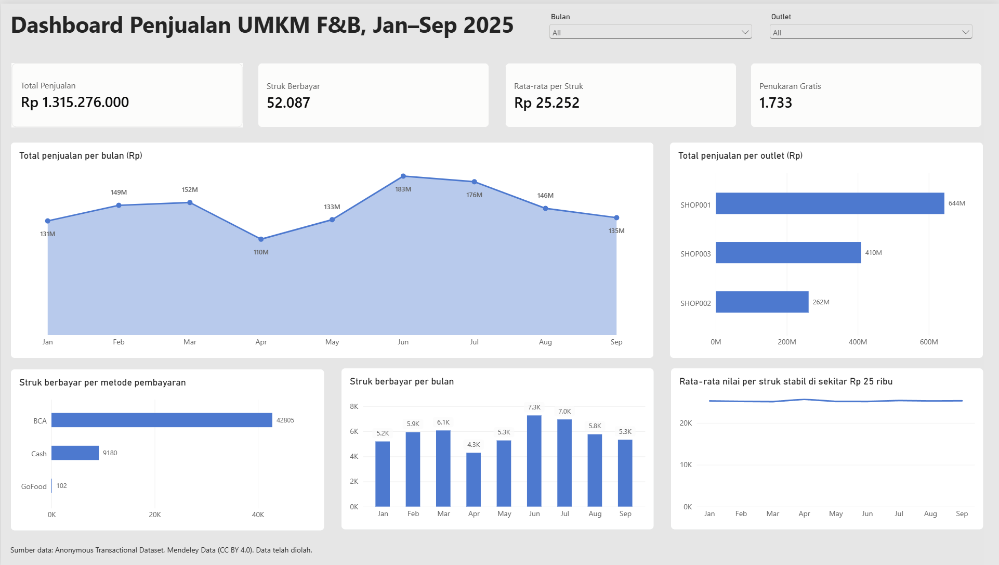
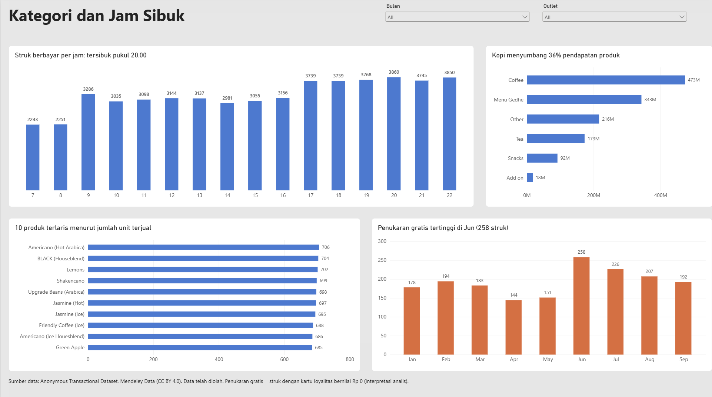

# Analisis Penjualan UMKM F&B (Jan–Sep 2025)

Notebook persiapan data (Python) dan dashboard 2 halaman (Power BI) dari data transaksi POS tiga outlet F&B skala UMKM. Proyek portofolio data analysis.





## Ringkasan

| Ukuran | Nilai |
|---|---|
| Periode | Januari–September 2025 |
| Outlet | 3 (SHOP001, SHOP002, SHOP003) |
| Total struk | 53.820 (52.087 berbayar, 1.733 penukaran gratis) |
| Total penjualan | Rp 1.315.276.000 |
| Rata-rata per struk berbayar | Rp 25.252 |
| Produk | 94 dari 96 produk pernah terjual |

## Pertanyaan yang dijawab

1. Bagaimana tren penjualan bulanan, dan outlet mana yang paling besar kontribusinya?
2. Kapan jam paling ramai?
3. Kategori dan produk apa yang paling menyumbang pendapatan?
4. Bagaimana pola penukaran kartu loyalitas?

## Temuan utama

- **Penjualan per bulan** berkisar Rp 110 juta (April, terendah) sampai Rp 183 juta (Juni, tertinggi).
- **Per outlet:** SHOP001 Rp 644 juta, SHOP003 Rp 410 juta, SHOP002 Rp 262 juta.
- **Jam tersibuk** adalah pukul 17.00–22.00 (sekitar 3.700–3.900 struk berbayar per jam), sedangkan pukul 07.00–08.00 paling sepi (sekitar 2.250).
- **Kategori:** Coffee 36% dari pendapatan produk, Menu Gedhe 26%, Other 16%, Tea 13%, Snacks 7%, Add on 1%.
- **Metode pembayaran:** BCA 42.805 struk, tunai 9.180, GoFood 102.
- **Rata-rata nilai per struk stabil** di sekitar Rp 25 ribu setiap bulan.
- **Penukaran gratis** tertinggi di Juni (258 struk) dan terendah di April (144).
- **Tidak ada produk andalan yang mencolok:** 10 produk terlaris hanya berkisar 685–706 unit, sedangkan rata-rata seluruh produk 641 unit (terendah 560).

## Metode

Seluruh persiapan data ada di `data_prep_umkm_fnb.ipynb`:

1. Profil data dan pengecekan kualitas.
2. Memecah kolom `Items` (satu struk, banyak produk) menjadi tabel `line_items` dengan `str.split(', ')` dan `explode`.
3. Validasi dengan `assert`, lalu menggabungkan ke `Products.csv` dengan `merge(validate='many_to_one')`.
4. Rekonsiliasi: jumlah harga produk pada struk berbayar sama persis dengan `TotalAmount` (Rp 1.315.276.000).
5. Kolom turunan: bulan, hari, jam, jenis pelanggan (bayar atau tukar loyalitas).
6. Ekspor `transactions_clean.csv`, `line_items.csv`, dan `products_clean.csv` untuk Power BI.

Model di Power BI: `transactions_clean` → `line_items` (per `ReceiptNumber`) ← `products_clean` (per `Item`), relasi satu-ke-banyak dengan arah filter tunggal. Ukuran (measure) ditulis dengan DAX.

## Struktur repositori

```
.
├── README.md
├── data_prep_umkm_fnb.ipynb
├── data/
│   └── raw/                 # unduh sendiri dari Mendeley (lihat tautan di bawah)
├── dashboard/
│   ├── Dashboard Penjualan UMKM.pbix
│   ├── Dashboard Penjualan UMKM.pdf
│   ├── halaman-1.png
│   └── halaman-2.png
```

## Cara menjalankan

1. Unduh `Products.csv` dan `Transactions.csv` dari tautan dataset di bawah, simpan di `data/raw/`.
2. Jalankan notebook dari awal sampai akhir (Python 3, pandas).
3. Buka `dashboard_umkm_fnb.pbix` di Power BI Desktop dan arahkan sumber data ke file hasil ekspor notebook.

## Keterbatasan data

- **Label "UMKM" berasal dari deskripsi dataset.** Data bersifat anonim dan identitas bisnisnya tidak dapat diverifikasi. Angka di sini adalah total tiga outlet dalam dataset, bukan klaim tentang satu usaha tertentu.
- **Pola yang sangat rata.** Penjualan antar produk dan antar hari, serta nilai rata-rata per struk, hampir seragam. Ini bisa berarti data sudah diolah atau disimulasikan. Temuan "tidak ada produk andalan" sebaiknya dibaca dengan hati-hati.
- **"Penukaran gratis" adalah interpretasi.** Struk dengan `UseLoyaltyCard = 1` selalu bernilai Rp 0, sehingga saya menganggapnya penukaran hadiah. Dataset tidak menjelaskan aturan programnya.
- **Harga memakai `Products.csv` yang berlaku saat ini.** Riwayat perubahan harga tidak tersedia.
- **Hanya sembilan bulan.** Tidak cukup untuk menyimpulkan pola musiman tahunan.
- Nama kategori dan produk dibiarkan sesuai dataset asli (termasuk salah ketik seperti "Houesblend").

## Sumber data dan atribusi

- **Data:** Anonymous Transactional Dataset
- **Penulis:** Mychael Maoeretz Engel, Ford Lumban Gaol, Aditya Kurniawan, Widodo Budiharto
- **Sumber:** Mendeley Data, V2. DOI: [10.17632/kcgf45y24m.2](https://doi.org/10.17632/kcgf45y24m.2)
- **Lisensi:** [Creative Commons Attribution 4.0 (CC BY 4.0)](https://creativecommons.org/licenses/by/4.0/)

**Perubahan yang dilakukan:** data dipecah per item, digabung dengan tabel produk, ditambah kolom turunan (waktu dan jenis pelanggan), dan diringkas dalam dashboard. Tidak ada klaim bahwa penulis dataset menyetujui atau mendukung analisis ini.

## Kontak

Sujata Mulyana — [LinkedIn](https://www.linkedin.com/in/sujata-mulyana/) · [Email](mailto:sujatamulyana01@gmail.com)
